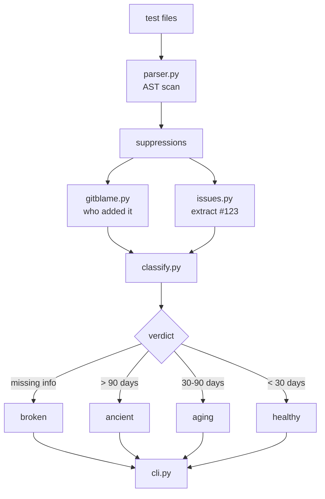

# mute

[](https://github.com/kallurayaankit/mute/actions/workflows/test.yml)
[](https://opensource.org/licenses/MIT)
[](https://www.python.org/downloads/)

**Find the tests your suite is quietly hiding.**

```bash
pip install -e .
mute audit tests/
```

## The problem

Every test suite hides things. Grep any real codebase:

```python
@pytest.mark.skip(reason="flaky, investigate later")   # 8 months ago
@pytest.mark.xfail(strict=False)                       # no reason given
@pytest.mark.skip("broken, see #1234")                # issue closed 6 months ago
```

That's a suite that isn't telling you the truth. Coverage tools report it as healthy because the code runs. Flake detectors report it as stable because the tests aren't running. `mute` looks at what's **turned off**.

## What it finds

| Kind | Where it lives |
|---|---|
| **Skip** | `@pytest.mark.skip` / `@pytest.mark.skipif` |
| **Xfail** | `@pytest.mark.xfail` |
| **Retry** | `flaky` / `rerun` / `retry` markers |

For each one, `mute` extracts the file, line, test name, reason, added-by, added-when, and any issue reference (`#123`, `GH-123`, `JIRA-123`, `BUG-123`).

## Four verdicts

| Verdict | Rule |
|---|---|
| `HEALTHY` | Has reason + linked issue, < 30 days old |
| `AGING` | Has reason + issue, 30–90 days old |
| `ANCIENT` | Has reason + issue, > 90 days old |
| `BROKEN` | Missing reason or missing issue |

Every `BROKEN` or `ANCIENT` suppression is a **hidden test** — a test that used to guard against regressions and is now doing nothing.

## Output

```
$ mute audit tests/

Found 14 suppressions in the test suite.

=== BROKEN (4) ===
  tests/test_auth.py::test_session_expiry
    kind:      skip
    reason:    "flaky, investigate later"
    added:     2026-02-12 by alice
    age:       245 days

  tests/test_api.py::test_rate_limit
    kind:      xfail
    reason:    (none)
    age:       120 days

=== ANCIENT (3) ===
  ...

=== HEALTHY (7) ===
  ...

=== STATS ===
  Total suppressions:     14
  Without a reason:        3
  Without a linked issue:  5
  Broken:                  4
  Ancient (>90 days):      3
  Aging (30-90 days):      0
  Healthy (<30 days):      7
```

## Architecture



## Quickstart

```bash
python -m venv .venv
.venv\Scripts\activate
pip install -e .

# audit your test directory
mute audit tests/

# with HTML report
mute audit tests/ --html report.html --open

# fail CI on broken or ancient suppressions
mute audit tests/ --fail-on-problems
```

## Configuration

`.env`:

```
MUTE_MAX_AGE_DAYS=90
MUTE_AGING_DAYS=30
```

## What this is not

- **Not a flake detector.** `pulse` finds tests that fail nondeterministically. `mute` finds tests that are turned off.
- **Not a coverage tool.** Coverage tells you which lines ran. `mute` tells you which tests didn't.
- **Not a CI gate.** It reads files. Wire it into CI with `--fail-on-problems`.

## Status

Early. Works on Python test files. Roadmap: check linked issue state via GitHub API, detect empty assertions, parse pyproject.toml for global `--reruns` config.

## License

MIT
